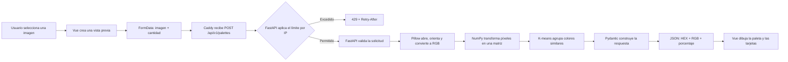
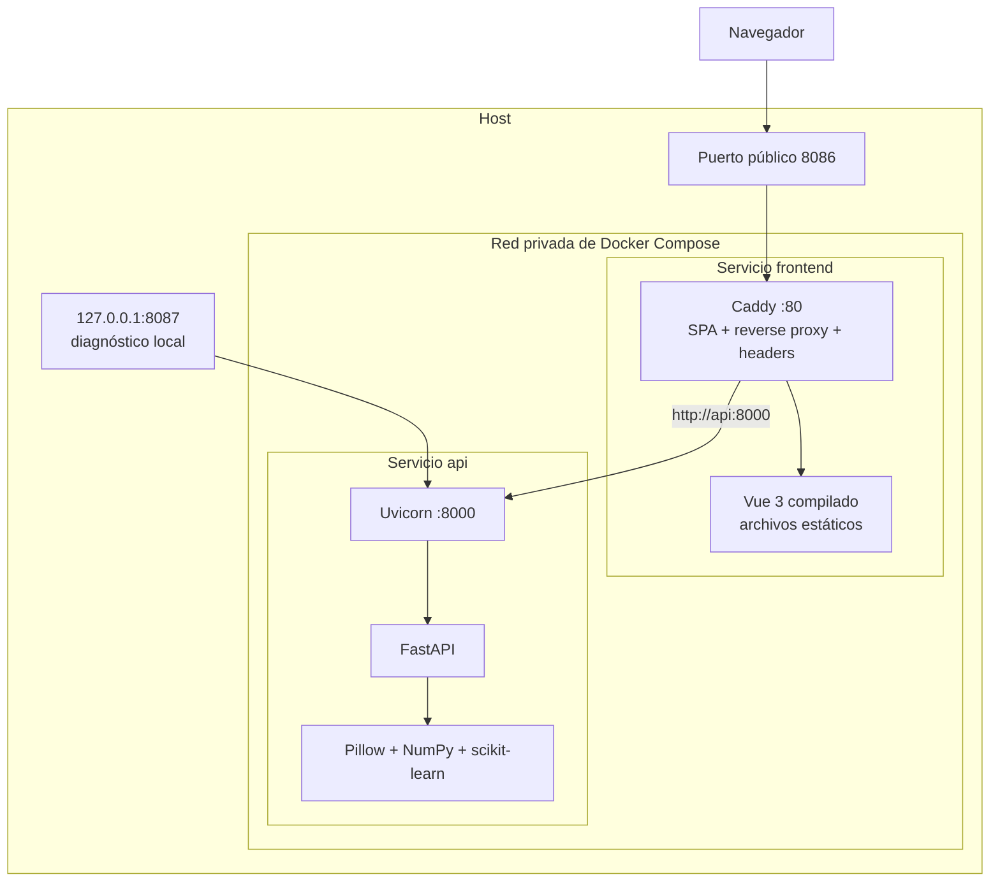
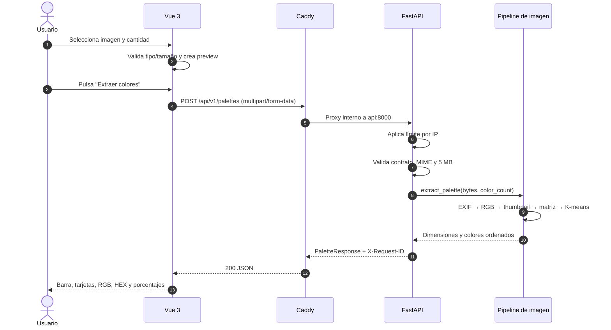
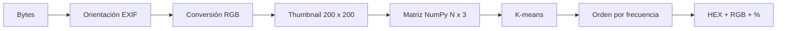

# API a todo color

> Taller full stack: de una imagen a una paleta de colores con Vue 3, FastAPI, K-means y Docker Compose.

API a todo color recibe una imagen, identifica sus colores predominantes y devuelve una paleta ordenada por frecuencia. El proyecto está construido como dos servicios independientes: una API versionada en FastAPI y una aplicación Vue 3 servida por Caddy.

[Ver la página del proyecto](https://menene.github.io/apicolors/) · [Abrir Swagger local](http://127.0.0.1:8086/docs) · [Revisar la API](#contrato-de-la-api)

## Lo que construimos

- Una interfaz Vue 3 para seleccionar, previsualizar y enviar imágenes.
- Una API FastAPI con rutas bajo `/api/v1` y documentación OpenAPI.
- Un pipeline de procesamiento con Pillow, NumPy y K-means.
- Una respuesta tipada con HEX, RGB, porcentaje y metadatos.
- Dos imágenes Docker independientes y una red administrada por Compose.
- Un servidor Caddy con reverse proxy, compresión y encabezados de seguridad.
- Rate limiting por IP en FastAPI, con un límite específico para el procesamiento K-means.
- Pruebas del contrato HTTP y del procesamiento de colores.

## Inicio rápido

Requisitos: Docker Engine o Docker Desktop con Docker Compose.

```bash
cp .env.example .env
docker compose up --build
```

Cuando ambos contenedores estén saludables:

| Recurso | URL |
| --- | --- |
| Aplicación | <http://127.0.0.1:8086> |
| Swagger | <http://127.0.0.1:8086/docs> |
| OpenAPI | <http://127.0.0.1:8086/openapi.json> |
| Ping | <http://127.0.0.1:8086/api/v1/ping> |
| API directa local | <http://127.0.0.1:8087> |

Detener los servicios:

```bash
docker compose down
```

## Flujo macro

Este es el recorrido completo, desde la acción del usuario hasta la paleta renderizada:



## Infraestructura

En producción local solo Caddy se expone públicamente. El frontend se comunica con FastAPI utilizando el nombre del servicio `api`, resuelto por la red interna de Docker Compose.



### Por qué dos servicios

La separación permite desplegar, escalar y probar cada parte de forma independiente:

- `frontend` compila Vue con Node y sirve el resultado con Caddy.
- `api` ejecuta únicamente Python, Uvicorn y las dependencias científicas.
- Caddy mantiene la SPA y las peticiones de la API en el mismo origen.
- Compose crea la red y el DNS interno; no se configuran direcciones IP manuales.

## Arquitectura del proyecto

```mermaid
flowchart TD
    ROOT[apicolors/]
    ROOT --> API[api/]
    ROOT --> WEB[frontend/]
    ROOT --> HOME[index.html<br/>página de GitHub Pages]
    ROOT --> SITECONFIG[site-config.js<br/>URL pública de la app]
    ROOT --> DECK[presentation/<br/>diapositivas Reveal.js]
    ROOT --> COMPOSE[docker-compose.yml]
    ROOT --> ENV[.env.example]

    API --> ENTRY[app/main.py<br/>aplicación y middleware]
    API --> ROUTERS[app/api/v1/<br/>routers y endpoints]
    API --> CONFIG[app/core/<br/>configuración y errores]
    API --> ENGINE[app/palette.py<br/>procesamiento K-means]
    API --> MODELS[app/schemas.py<br/>contratos Pydantic]
    API --> TESTS[tests/<br/>API y algoritmo]
    API --> APIDOCKER[Dockerfile]

    WEB --> APP[src/App.vue<br/>estado e interacción]
    WEB --> STYLE[src/styles.css<br/>sistema visual]
    WEB --> VITE[vite.config.js<br/>build y proxy de desarrollo]
    WEB --> CADDY[Caddyfile<br/>proxy, seguridad y SPA]
    WEB --> WEBDOCKER[Dockerfile<br/>build multi-stage]

```



```text
.
├── api/
│   ├── app/
│   │   ├── api/v1/endpoints/   # Ping y paletas
│   │   ├── core/               # Configuración y errores
│   │   ├── main.py             # FastAPI y middleware
│   │   ├── palette.py          # Algoritmo
│   │   └── schemas.py          # Modelos de respuesta
│   ├── tests/
│   ├── Dockerfile
│   └── requirements.txt
├── frontend/
│   ├── src/
│   │   ├── App.vue
│   │   ├── main.js
│   │   └── styles.css
│   ├── Dockerfile
│   ├── Caddyfile
│   └── vite.config.js
├── index.html                  # Landing page estática
├── site-config.js             # Configuración pública de la landing
├── scripts/
│   └── generate_site_config.py # Genera site-config.js desde .env
├── presentation/
│   ├── assets/                 # Recursos visuales de las diapositivas
│   └── presentation.html       # Taller en Reveal.js
├── .env.example
└── docker-compose.yml
```

## Secuencia de una solicitud



## Cómo está construido

### 1. API y versionado

`api/app/main.py` crea la aplicación, instala middleware y registra el router principal. Los endpoints no viven en el archivo de entrada: se agrupan bajo `app/api/v1`, lo que mantiene estable el contrato actual y permite agregar `/api/v2` sin romper clientes existentes.

Rutas actuales:

| Método | Ruta | Propósito |
| --- | --- | --- |
| `GET` | `/api/v1/ping` | Disponibilidad del servicio |
| `POST` | `/api/v1/palettes` | Extraer la paleta de una imagen |
| `GET` | `/docs` | Swagger UI |
| `GET` | `/openapi.json` | Esquema OpenAPI |

### 2. Procesamiento de la imagen

El backend nunca guarda la imagen en disco. El archivo se lee con un límite de 5 MB y se procesa en memoria:

1. Pillow abre los bytes y aplica la orientación EXIF.
2. La imagen se convierte a RGB para normalizar PNG, JPEG y WebP.
3. Se reduce a un máximo de `200 × 200` para controlar costo y memoria.
4. NumPy transforma los píxeles en filas `[red, green, blue]`.
5. Se limita el número de clusters a los colores realmente distintos.
6. `KMeans` agrupa píxeles similares con un resultado reproducible.
7. Los clusters se ordenan por frecuencia y se convierten a HEX, RGB y porcentaje.



### 3. Contratos y errores

Pydantic valida y documenta las respuestas. Los errores mantienen la misma forma en toda la API:

```json
{
  "error": {
    "code": "invalid_image",
    "message": "No fue posible leer la imagen.",
    "request_id": "50614e14-b7f9-47b3-9d1e-717b3fcad570"
  }
}
```

`X-Request-ID` aparece también en los encabezados para correlacionar navegador, proxy y backend.

### 4. Frontend Vue 3

`frontend/src/App.vue` utiliza Composition API y estado reactivo para controlar:

- Archivo seleccionado y URL temporal de preview.
- Cantidad de colores entre 3 y 8.
- Drag and drop y validación inmediata.
- Estado de carga y errores de red/API.
- Respuesta de la paleta y copia al portapapeles.

La petición usa una ruta relativa:

```js
await fetch("/api/v1/palettes", {
  method: "POST",
  body: formData,
});
```

Esto funciona en ambos entornos: Vite usa su proxy durante desarrollo y Caddy usa `reverse_proxy` dentro de Docker.

### 5. Frontend Docker

El Dockerfile del frontend tiene dos etapas:

1. `node:20-alpine` instala dependencias y ejecuta `vite build`.
2. `caddy:alpine` recibe solamente `dist/` y el `Caddyfile`.

Node no queda en la imagen final. El resultado es más pequeño y expone menos componentes en producción.

### 6. Backend Docker

El contenedor de la API:

- Parte de una imagen Python slim.
- Instala dependencias antes de copiar el código para aprovechar cache de capas.
- Ejecuta como usuario sin privilegios.
- Inicia Uvicorn en `0.0.0.0:8000`.
- No contiene las pruebas ni archivos locales gracias a `.dockerignore`.

### 7. Docker Compose

Compose construye los servicios, crea una red privada y espera a que `/api/v1/ping` responda antes de iniciar el frontend. Caddy usa `http://api:8000`; `api` es el nombre DNS del servicio, no una dirección IP fija.

El puerto directo de la API se publica en `127.0.0.1`, por lo que no queda expuesto a otras máquinas. Para uso público se utiliza el proxy del frontend.

### 8. Seguridad por capas

| Capa | Control |
| --- | --- |
| Navegador/API | CORS con orígenes explícitos y sin credenciales |
| FastAPI | Hosts permitidos, validación tipada y request IDs |
| Endpoint | MIME permitido, lectura limitada y decodificación real de la imagen |
| FastAPI | Rate limiting general y específico para K-means |
| Caddy | Límite de carga, compresión y encabezados de seguridad |
| Respuesta | `nosniff`, anti-framing, referrer y permissions policy |
| Contenedor | Usuario no root y contexto de build reducido |

CORS controla qué orígenes de navegador pueden leer la API; no reemplaza autenticación ni rate limiting.

## Contrato de la API

### Ping

```bash
curl http://127.0.0.1:8086/api/v1/ping
```

```json
{"message":"pong"}
```

### Crear una paleta

```bash
curl -X POST http://127.0.0.1:8086/api/v1/palettes \
  -F "image=@./mi-imagen.png" \
  -F "color_count=5"
```

Parámetros:

| Campo | Tipo | Regla |
| --- | --- | --- |
| `image` | Archivo | JPEG, PNG o WebP; máximo 5 MB |
| `color_count` | Entero | Entre 3 y 8; predeterminado 5 |

Respuesta abreviada:

```json
{
  "filename": "mi-imagen.png",
  "color_count": 5,
  "width": 1600,
  "height": 900,
  "processing_ms": 48.21,
  "colors": [
    {
      "hex": "#264653",
      "rgb": {"red": 38, "green": 70, "blue": 83},
      "percentage": 34.7
    }
  ]
}
```

## Configuración

`.env.example` documenta las variables que Compose consume:

| Variable | Predeterminado | Uso |
| --- | --- | --- |
| `APP_PORT` | `8086` | Puerto público de Caddy y Vue |
| `APP_URL` | `http://127.0.0.1:8086` | URL pública del botón **Abrir app** |
| `API_PORT` | `8087` | Puerto local de diagnóstico de FastAPI |
| `CORS_ORIGINS` | Orígenes Vite locales | Lista separada por comas |
| `TRUSTED_HOSTS` | Hosts locales y de Docker | Valores válidos del encabezado `Host` |
| `API_RATE_LIMIT` | `10/second` | Límite general por dirección IP |
| `PALETTE_RATE_LIMIT` | `2/second` | Límite del endpoint de procesamiento |

```bash
cp .env.example .env
```

Para producción, agrega el dominio real a `TRUSTED_HOSTS`. Agrega un origen a `CORS_ORIGINS` solamente si otro sitio consumirá la API directamente desde el navegador.

La landing es estática y no puede leer `.env` en el navegador. Después de cambiar `APP_URL`, genera su configuración pública:

```bash
python3 scripts/generate_site_config.py
```

Este comando actualiza `site-config.js`, que GitHub Pages sí puede servir. Este archivo solo debe contener valores públicos.

## Desarrollo sin Docker

### API

```bash
python3 -m venv .venv
source .venv/bin/activate
pip install -r api/requirements.txt
cd api
uvicorn app.main:app --reload --port 8087
```

### Frontend

En otra terminal:

```bash
cd frontend
npm install
npm run dev
```

Vite abre <http://127.0.0.1:5173> y reenvía `/api` a <http://127.0.0.1:8087>. Para cambiar ese destino:

```bash
VITE_API_PROXY_TARGET=http://127.0.0.1:9000 npm run dev
```

## Pruebas y verificación

Backend:

```bash
cd api
pytest
```

Frontend:

```bash
cd frontend
npm run build
```

Stack completo:

```bash
docker compose config
docker compose up --build -d
docker compose ps
docker compose logs -f
```

Si no deseas instalar Python localmente, puedes ejecutar las pruebas dentro de la imagen:

```bash
docker compose run --rm -v ./api:/app api pytest
```

## Recorrido del taller

Las ramas son checkpoints acumulativos. Cada una representa el resultado terminado de una sección:

| Rama | Resultado visible |
| --- | --- |
| `00-starter` | FastAPI mínima, Docker Compose y prueba inicial |
| `01-api-foundation` | FastAPI, `/api/v1/ping`, modelos y Swagger |
| `02-palette-api` | Upload, validaciones, K-means y tests del backend |
| `03-production-hardening` | CORS, hosts, request IDs, rate limiting y errores uniformes |
| `04-frontend` | Vue 3, preview, `FormData`, Caddy y paleta interactiva |
| `main` | Solución final, documentación y material del taller |

Si alguien queda atrás, puede continuar desde el checkpoint terminado:

```bash
git switch 03-production-hardening
docker compose up --build
```

## Publicar la página del proyecto

La landing vive en `index.html`, en la raíz, y no depende del backend. La presentación Reveal.js vive en `presentation/presentation.html` y se publica junto con la landing. En GitHub:

1. Abre **Settings → Pages**.
2. Selecciona **Deploy from a branch**.
3. Elige `main` y la carpeta `/ (root)`.
4. Guarda y espera el despliegue.

La URL esperada es `https://menene.github.io/apicolors/`.

La presentación queda disponible en `https://menene.github.io/apicolors/presentation/presentation.html`.

## Solución de problemas

### El puerto está ocupado

Modifica `.env`:

```dotenv
APP_PORT=8090
API_PORT=8091
```

### La API responde `Invalid host header`

Agrega el hostname exacto a `TRUSTED_HOSTS` y recrea el contenedor:

```bash
docker compose up --build -d api
```

### El navegador bloquea una petición CORS

Agrega el origen completo —protocolo, hostname y puerto— a `CORS_ORIGINS`. No uses `*` como arreglo rápido en producción.

### Docker no puede crear una red

Revisa redes sin uso con `docker network ls` y limpia solamente recursos que reconozcas. Compose administra el DNS por nombre de servicio; el proyecto no necesita subredes fijas.

## Licencia y autor

Material de taller creado por [Erick Marroquin](https://github.com/menene).
